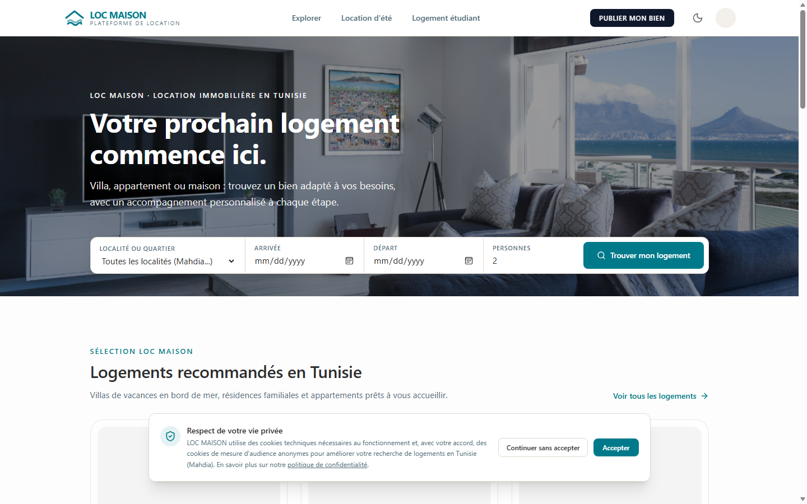
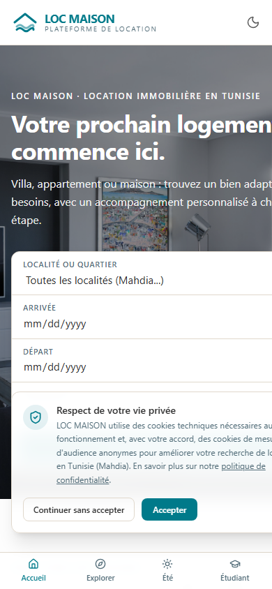
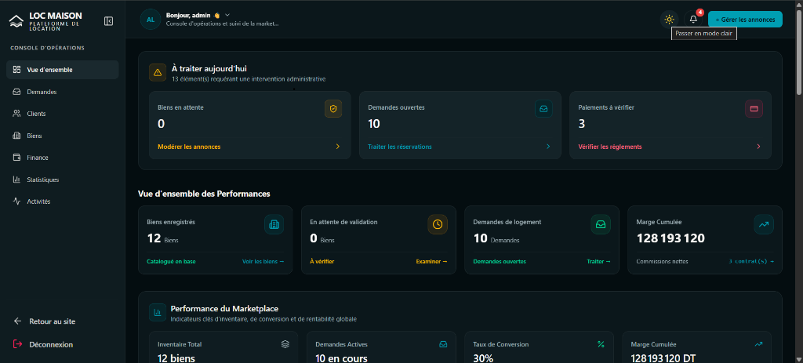
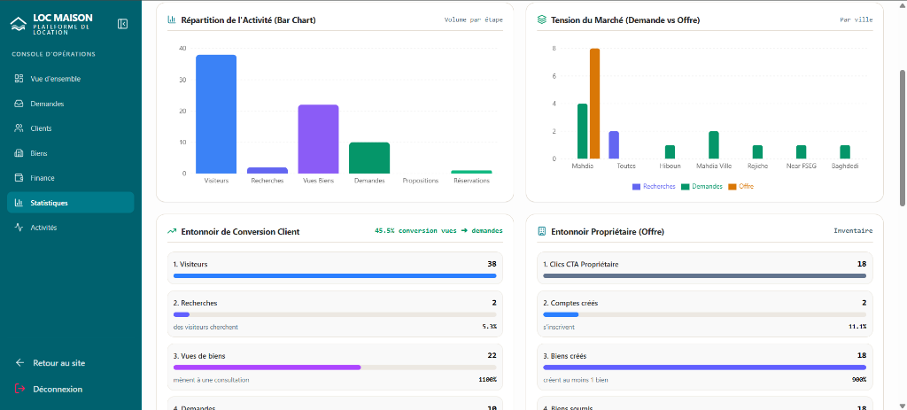

# LOC MAISON — Tunisian Managed Rental Marketplace

> **Verified property listings, matching engine, and auditable reservation workflow for the Tunisian real estate market.**  
> *Developed by [Micro Edition](https://microedition.tn/) · Founder & Technical Lead: Akrem Barboura*

[-black?logo=next.js)](https://nextjs.org/)
[](https://react.dev/)
[](https://www.typescriptlang.org/)
[](https://tailwindcss.com/)
[](https://www.mongodb.com/)
[-success?logo=vitest)](https://vitest.dev/)
[](LICENSE)

[**🚀 Explore Live Demo (Deployed on Vercel)**](https://location-match.vercel.app)  
*(Interactive preview of the marketplace client experience and operations portal.)*

---

## 📸 Product Preview

### 1. Marketplace Discovery & Mobile Experience
Clean real estate discovery experience supporting seasonal vacation houses, student accommodations, and category filters (Villas, Waterfront, Pools). Built fully responsive with touch-first controls for mobile users.

| Desktop (1440px Viewport) | Mobile (390px Viewport) |
| :---: | :---: |
|  |  |

> 💡 **Design & UX Highlights**: Multi-category filter pills with instant client-side state, localized Tunisian date formatting, and touch-optimized request modals designed for low-friction conversion.

### 2. Operational Admin Console (Dark & Light Mode)
Real-time administrative operations hub featuring pending listing moderation, open client request dispatching, and two-tier payment verification.



> 💡 **Operational Workflow**: Summarizes high-priority action items into single-click workflows: *"Biens en attente"*, *"Demandes ouvertes"*, and *"Paiements à vérifier"*.

### 3. Market Intelligence & Conversion Funnels
Interactive analytics dashboard tracking visitor funnels, supply vs. demand market tension across Tunisian coastal cities (Mahdia, Hiboun, Rejiche), and cumulative platform margins.



> 💡 **Marketplace Analytics**: Correlates tenant search volumes against active landlord inventory to guide geographic marketing and property acquisition.

---

## 🌟 Executive Overview

**LOC MAISON** is a managed rental platform engineered specifically for the Tunisian marketplace. Unlike unmoderated instant-booking directories, LOC MAISON introduces a structured operational layer where:
- Property listings are physically or documentarily verified by administrators before publication.
- Tenant requests (for summer vacations or university housing) are matched algorithmically and reviewed by operations.
- Direct customer contact information is shielded until reservations and payment commitments are verified.
- Financial obligations and cash payment declarations undergo strict dual-confirmation auditing.

### Role-Scoped Interfaces
- **Tenants & Students**: Filter verified listings, submit structured rental requests, track proposal stages, and receive automated SMS/Email updates.
- **Property Owners**: Manage listing details, track booking calendars, declare received cash payments, and view check-in schedules.
- **Administrators**: Moderate submissions, match tenant requests with landlords, audit offline payments, and track platform metrics.

---

## 🏛️ Core Architecture & Domain Invariants

The platform is designed around strict separation of concerns, transactional safety, and business-level security policies.

### 1. Controlled Contact Masking Engine
To protect the integrity of the marketplace and prevent disintermediation prior to a formal agreement, tenant contact details (phone, email, WhatsApp) are masked by default. Contact access is granted only after a reservation reaches `CONFIRMED` and its payment is `VERIFIED`.

> 📘 **Full Architecture Blueprint**: See the [Contact Release Policy Diagram & Spec](docs/architecture/SYSTEM_DESIGN_AND_FSM.md#3-controlled-customer-contact-release-policy).

### 2. Guarded Finite State Machine (Stage A → Stage F)
Rental inquiries progress through a six-stage Finite State Machine (FSM):
1. **Stage A**: Request Submitted
2. **Stage B**: Dates & Preferences Verified
3. **Stage C**: Terms Negotiated with Owner
4. **Stage D**: Commission Terms Locked
5. **Stage E**: Payment Verified by Admin
6. **Stage F**: Reservation Confirmed & Contacts Released

> 📘 **Full State Machine Specification**: See the [Stage A–F Lifecycle Documentation](docs/architecture/SYSTEM_DESIGN_AND_FSM.md#2-finite-state-machine-stage-a--stage-f-lifecycle).

### 3. Dual-Confirmation Payment Audit Trail
To accommodate local payment methods (cash on site, bank transfer, D17), physical cash handoffs must first be declared by the owner (`Payment.status = REPORTED`) and subsequently audited and approved by an administrator (`Payment.status = VERIFIED`), maintaining an immutable audit log. Both views consume state via the repository-level helper [`src/lib/payment-status.ts`](src/lib/payment-status.ts).

> 📘 **Payment State Machine Details**: See the [Payment Audit Documentation](docs/architecture/SYSTEM_DESIGN_AND_FSM.md#4-dynamic-payment-workflow--single-source-of-truth).

### 4. Distributed Atomic Rate Limiter
Public endpoints, authentication workflows, and image uploads are protected by an atomic, distributed MongoDB-backed rate limiter (`MongoStore`). This eliminates the weaknesses of in-memory stores in serverless environments.

> 📘 **Security Architecture**: See the [Security, Auth & Rate Limiting Guide](docs/backend/SECURITY_AUTH_RATE_LIMITING.md).

---

## 🛠️ Technology Stack

| Layer | Technologies |
| :--- | :--- |
| **Framework** | [Next.js 15](https://nextjs.org/) (App Router, Server Actions, Route Handlers) |
| **Frontend UI** | [React 19](https://react.dev/), [Tailwind CSS v4](https://tailwindcss.com/), [Framer Motion](https://www.framer.com/motion/) |
| **Icons & Design** | [Lucide React](https://lucide.dev/), Radix UI Primitives, Sonner Toaster |
| **Language** | [TypeScript](https://www.typescriptlang.org/) (Strict Mode) |
| **Database & ODM** | [MongoDB Atlas](https://www.mongodb.com/atlas), [Mongoose 9](https://mongoosejs.com/) |
| **Client State & Cache**| [TanStack Query v5](https://tanstack.com/query/latest) |
| **Validation** | [Zod](https://zod.dev/), React Hook Form |
| **Security & Auth** | Stateless signed JWT HTTP-Only Cookies (`jose`), `bcryptjs`, HMAC OTP verification |
| **Media Pipeline** | [Cloudinary API](https://cloudinary.com/) (Secure server-side upload & transformations) |
| **Testing Engine** | [Vitest](https://vitest.dev/), Testing Library, `@testing-library/react` |
| **CI / Automation** | GitHub Actions (`ci.yml`, `security.yml`) |

---

## 🛣️ Application Routes

| Category | Path | Description | Access |
| :--- | :--- | :--- | :--- |
| **Public** | `/` | Marketplace landing page & global search | Public |
| | `/houses` | Verified property catalog | Public |
| | `/houses/[slug]` | Individual property details & booking request | Public |
| | `/summer` | Vacation rentals catalog | Public |
| | `/student` | University student housing catalog | Public |
| | `/request/summer` | Vacation rental structured wizard | Public / Tenant |
| | `/request/student` | Student accommodation request wizard | Public / Student |
| | `/login` & `/register` | Authentication with cookie-based JWT | Public |
| **Customer** | `/dashboard` | Tenant request tracking & active reservations | `CUSTOMER` |
| | `/request/[id]` | Real-time negotiation & payment status tracker | `CUSTOMER` |
| **Owner** | `/owner` | Owner overview & operational KPI summary | `OWNER` |
| | `/owner/properties` | Property portfolio & listing manager | `OWNER` |
| | `/owner/calendar` | Availability calendar & check-in schedules | `OWNER` |
| | `/owner/reservations` | Reservation list & cash payment declaration | `OWNER` |
| **Admin** | `/admin` | Operations console & daily action items | `ADMIN` |
| | `/admin/properties` | Listing moderation & verification queue | `ADMIN` |
| | `/admin/requests` | Request matching & proposal management | `ADMIN` |
| | `/admin/analytics` | Marketplace KPIs, city demand & conversion funnels | `ADMIN` |

---

## 🧪 Testing & Verification

The codebase maintains automated test coverage across authentication, rate limiting, pricing algorithms, state machines, and contact-release invariants.

```bash
# Run complete test suite via Vitest
npm test
```

### Verified Test Run:
```text
 ✓ tests/properties/admin-reservation.test.ts (13 tests)
 ✓ tests/analytics/analytics.test.ts (13 tests)
 ✓ tests/finance/commission-negotiation-workflow.test.ts (6 tests)
 ✓ tests/owner/contact-release.test.ts (12 tests)
 ✓ tests/rate-limit/mongo-store.test.ts (3 tests)
 ✓ tests/pricing/canonical-pricing.test.ts (13 tests)
 ...
 Test Files  41 passed (41)
      Tests  250 passed (250)
   Duration  ~19s
```

- **Type Safety**: `npx tsc --noEmit`
- **Linting**: `npm run lint`
- **Continuous Integration**: Every pull request and push to `main` runs type checking, linting, and the complete 250-test test suite via GitHub Actions.

---

## 🚀 Getting Started & Local Setup

### 1. Prerequisites
- **Node.js**: `v20.x` or higher
- **npm**: `v10.x` or higher
- **MongoDB**: Local MongoDB instance (`mongodb://127.0.0.1:27017`) or a free MongoDB Atlas cluster
- **Cloudinary Account**: For property image hosting (free tier suffices)

### 2. Installation

```bash
# Clone the repository
git clone https://github.com/akrembarboura/location-match.git
cd location-match

# Install dependencies
npm install

# Copy environment variables template
cp .env.example .env.local
```

### 3. Environment Variables Configuration

Open `.env.local` and configure your local placeholder values:

```env
# Database connection
MONGODB_URI=mongodb://127.0.0.1:27017/location_match

# Authentication Secret (Generate at least 32 random characters)
JWT_SECRET=your_local_development_jwt_secret_key_32_chars_min

# App URL (Default Next.js dev port)
NEXT_PUBLIC_APP_URL=http://localhost:3000

# Cloudinary Media Storage (Replace with your sandbox/test credentials)
CLOUDINARY_URL=cloudinary://<API_KEY>:<API_SECRET>@<CLOUD_NAME>
NEXT_PUBLIC_CLOUDINARY_CLOUD_NAME=<CLOUD_NAME>

# Email Service (Optional for development; falls back to terminal logger)
RESEND_API_KEY=re_your_resend_api_key_placeholder
```

> ⚠️ **Security Warning**: Never commit real API keys or database connection strings containing credentials to version control. The repository enforces `.gitignore` on all `.env*.local` files.

### 4. Running the Development Server

```bash
npm run dev
```

The application will be accessible at:  
👉 **`http://localhost:3000`**

### 5. Running Quality Checks

```bash
# Verify TypeScript compilation
npx tsc --noEmit

# Run Next.js and ESLint checks
npm run lint

# Execute Vitest test suite
npm test

# Verify production build
npm run build
```

---

## 📜 Intellectual Property & Rights

**LOC MAISON** is a proprietary commercial application developed by **Micro Edition**.  
© 2026 Micro Edition. All rights reserved.

- **Developer & Agency**: [Micro Edition](https://microedition.tn/)
- **Founder & Lead Engineer**: Akrem Barboura
- **Commercial Rights**: All trademarks, design assets, and business logic are proprietary property of Micro Edition.
