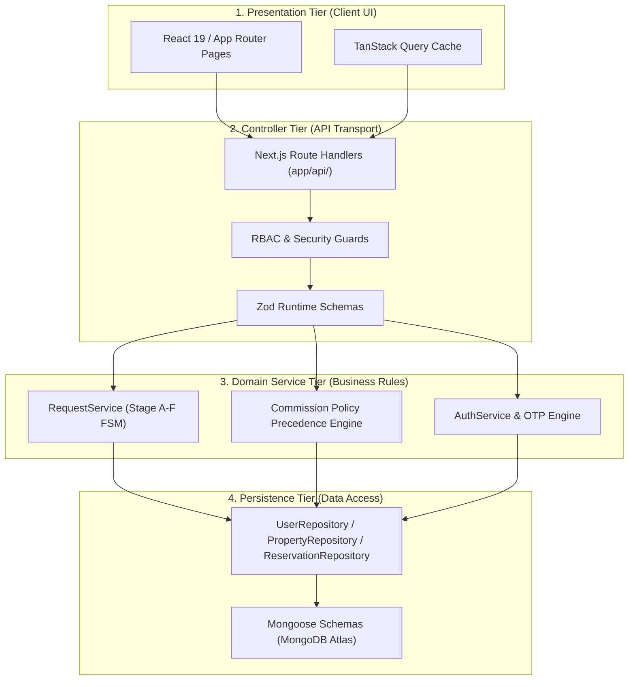
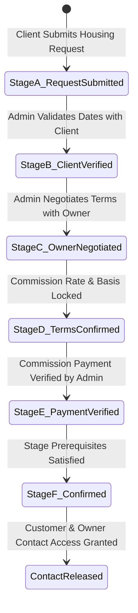

# 🏛️ LOC MAISON — System Architecture & State Machine Blueprint

> 📌 **DOCUMENT PROPERTIES**
> - **Category**: Enterprise Architecture & State Machine Design
> - **Stack**: Next.js 15, Clean Architecture, Finite State Machines (FSM), Immutable Accounting
> - **Authoritative Literature References**:
>   - 📚 *Clean Architecture: A Craftsman's Guide to Software Structure and Design* by Robert C. Martin ("Uncle Bob")
>   - 📚 *Enterprise Integration Patterns* by Gregor Hohpe & Bobby Woolf
>   - 📚 *Building Microservices* by Sam Newman

---

## 📌 Executive Summary

This document specifies the system architecture and state machine lifecycles of LOC MAISON. The application adopts **Clean 4-Tier Architecture** combined with **Guarded Finite State Machines** for multi-stage rental negotiation workflows.

---

## 🏗️ 1. Clean 4-Tier System Layering



---

## 🔄 2. Finite State Machine (Stage A → Stage F Lifecycle)

To prevent race conditions, domain state transitions are strictly guarded by prerequisite validation:



---

## 🔐 3. Controlled Customer Contact Release Policy

To protect marketplace integrity and prevent disintermediation before reservation and payment validation, LOC MAISON enforces a **Server-Side Contact Masking & Release Engine** (`ContactReleasePolicy`).

```text
               Customer Contact Data (Phone, Email, WhatsApp)
                                    │
                                    ▼
                ┌───────────────────────────────────────┐
                │   Server-Side Evaluation Policy       │
                └───────────────────┬───────────────────┘
                                    │
               ┌────────────────────┴────────────────────┐
               │  Is Authorized Owner?                   │
               │  Is Reservation Status CONFIRMED?       │
               │  Is Payment State VERIFIED / REPORTED?  │
               └────────────────────┬────────────────────┘
                                    │
                   ┌────────────────┴────────────────┐
                   │                                 │
                   ▼                                 ▼
             NO (Default)                        YES (Satisfied)
   ┌──────────────────────────────┐  ┌──────────────────────────────┐
   │ Contact Status: HIDDEN       │  │ Contact Status: RELEASED     │
   │ Phone: null                  │  │ Phone: +216 20 000 000       │
   │ Name: "Foulen B."            │  │ Name: "Foulen Ben Foulen"    │
   └──────────────────────────────┘  └──────────────────────────────┘
```

> **Security Invariant**: Unreleased contact data is stripped at the **API & Repository level**. It is never transferred to the browser or hidden via CSS, eliminating client-side inspection vulnerabilities.

---

## 💳 4. Dynamic Payment Workflow & Single Source of Truth

LOC MAISON implements a domain-driven payment state machine (`PaymentModel`) to track cash, bank transfer, D17, and online transactions with full audit trails.

### Conceptual Payment Model

```typescript
type PaymentMethod = "CASH" | "BANK_TRANSFER" | "D17" | "ONLINE" | "OTHER";

type PaymentStatus =
  | "PENDING"
  | "AWAITING_OWNER_CONFIRMATION"
  | "REPORTED"
  | "VERIFIED"
  | "CONFIRMED"
  | "REJECTED"
  | "REFUNDED";
```

### Owner Cash Confirmation & Audit Flow (`REPORTED` ≠ `VERIFIED`)

```text
Customer selects Cash Payment
             │
             ▼
Physical Cash Paid to Owner
             │
             ▼
Owner Clicks "Paiement reçu"  ──►  Payment.status = REPORTED (Owner Audit)
             │
             ▼
LOC MAISON Admin Audit        ──►  Payment.status = VERIFIED / CONFIRMED
             │
             ▼
Contact Released to Owner & Customer Sees "Paiement confirmé"
```

1. **Single Source of Truth**: Payment state is saved in MongoDB (`PaymentModel` + `ReservationModel.paymentSummary`) and synced to `HousingRequestModel`. Both Customer and Owner views consume the identical server state via [`src/lib/payment-status.ts`](../../src/lib/payment-status.ts).
2. **Auditability**: When an owner confirms physical receipt of cash, `Payment.status` transitions to `REPORTED`. LOC MAISON platform admins verify the record to set `VERIFIED`, preserving a full audit log (`reportedBy`, `reportedAt`, `verifiedBy`, `verifiedAt`, `history`).

---

## 🔄 5. End-to-End Marketplace Lifecycle Sequence

```text
 Property Owner               LOC MAISON Platform             Customer
───────────────              ─────────────────────           ──────────
       │                               │                         │
       ├──► Create Listing (DRAFT) ───►│                         │
       │    Submit for Review          │                         │
       │                               ├──► Moderation & Publish │
       │                               │    (/houses)            │
       │                               │                         │
       │                               │◄── Submit Request ──────┤
       │                               │    (Summer/Student)     │
       │                               │                         │
       │◄── View Reservation (Masked) ─┤                         │
       │    Receive Physical Cash      │                         │
       ├──► Report Cash Payment ──────►│                         │
       │    (Status: REPORTED)         ├──► Admin Verification   │
       │                               │    (Status: VERIFIED)   │
       │                               │                         │
       │◄── Release Customer Contact ──┤                         │
       │    (Status: RELEASED)         ├──► Paiement confirmé ──►│
```

---

## 📚 3. Engineering Literature References

- 📘 **Martin, R. C. (2017).** *Clean Architecture*. Boundaries, dependency inversion rule, and domain model protection.
- 📙 **Hohpe, G., & Woolf, B. (2003).** *Enterprise Integration Patterns*. Message routing, state management, and enterprise integration topologies.
